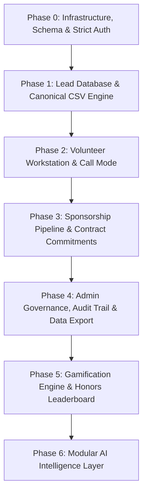

# PRAROHA'26 Sponsorship Outreach & Volunteer Execution System — Master Build Plan

## Current implementation status — redesign sprint

**Overall completion: 68%**

| Area | Status | Notes |
|---|---:|---|
| P0 Foundation & outreach execution | 82% | Core auth, lead assignment, call mode, debriefs, and follow-up persistence exist. Follow-up reschedule/cancel controls were added in this sprint. |
| P1 Sponsorship operations | 76% | Pipeline, packages, proposals, commitments, and in-kind valuation are present; cross-route QA remains. |
| P2 AI assistance | 70% | Server-side AI routes and deterministic fallbacks exist; production credential/degraded-service QA remains. |
| P3 Team management | 68% | Admin overview, verification, points, leaderboard, and workload views exist; responsive/theme QA remains. |
| P4 Supporting features | 72% | Search, filters, exports, audit logs, notifications, and data management exist; baseline lint debt remains. |
| Security and quality assurance | 46% | TypeScript and production build pass. Full route, role, responsive, empty-state, and Light/Dark matrix is not yet complete. |

### Redesign sprint changes

- **[COMPLETED]** Product-led landing experience using real sponsorship-workspace UI preview.
- **[COMPLETED]** Focused split authentication frame for sign-in and sign-up without oversized decorative artwork.
- **[COMPLETED]** Semantic Light/Dark token contract for surfaces, borders, text, input states, focus, and status colors.
- **[COMPLETED]** Shared primitive updates for buttons, cards, badges, inputs, selects, and theme toggle.
- **[COMPLETED]** Volunteer workspace header reframed around next action, assigned leads, priority, and points.
- **[COMPLETED]** Removed fake generic lead payload from the workspace shell call action; it now starts only from an actual assigned lead.
- **[COMPLETED]** Follow-up reschedule and cancel mutations with volunteer ownership checks and an accessible reschedule dialog.
- **[COMPLETED]** Removed misleading Active/Live navigation badges and changed visible admin states to semantic tokens.
- **[IN PROGRESS]** Full visual pass across every existing admin, volunteer, dialog, chart, and mobile surface.
- **[IN PROGRESS]** Strict lint cleanup across legacy modules containing pre-existing `any` usage and JSX escaping issues.
- **[NOT STARTED]** Complete manual Light/Dark × desktop/tablet/mobile QA matrix for every major route.

### Remaining blockers

- Full lint currently reports pre-existing errors across legacy admin, AI, Convex, and form modules; targeted changed files pass lint.
- Manual browser verification still needs to cover authenticated Clerk/Convex states and real populated data.
- The repository still contains a few development/security-test seed mutations; these are not rendered by production views but require an explicit deployment policy review.

### Known limitations

- The new public root landing page no longer acts as the authenticated central dispatcher; authenticated users should enter through the workspace/admin routes after sign-in.
- Full visual pass across every legacy admin, volunteer, dialog, chart, and mobile surface is still pending; the highest-traffic workspace and entry surfaces have been addressed first.

### QA status

- TypeScript: **PASS**
- Production build: **PASS**
- Targeted lint on changed files: **PASS**
- Full repository lint: **NOT PASSING** due to pre-existing legacy errors and warnings
- Manual route/theme QA: **PENDING**

**Document Version:** 2.0 (Post-Audit & Admin Operational Hardening)  
**Classification:** Internal Operational Cockpit — School of Engineering, CUSAT (Civil Engineering Dept)  
**Architectural Baseline:** Convex Real-Time Database + Next.js App Router (TypeScript Strict) + Clerk Auth + Tailwind CSS v4

---

## 1. Executive Summary & Core Engineering Philosophy

The PRAROHA'26 Sponsorship System is an internal, high-velocity operational cockpit purpose-built for the student sponsorship committee of PRAROHA'26. 

### Core Product Directives
1. **Operations First, AI Second:** The foundational hierarchy is:
   $$\text{LEADS} \longrightarrow \text{CALLS} \longrightarrow \text{FOLLOW-UPS} \longrightarrow \text{PROPOSALS} \longrightarrow \text{NEGOTIATION} \longrightarrow \text{SPONSORSHIP}$$
   The entire application is 100% operational with full database CRUD and auditability even if external AI APIs are offline.
2. **Single-Page Volunteer Workstation Rule:** Student SDRs work strictly within `/workspace` via contextual drawers, modals, and the minimal in-call overlay. No multi-tab fragmentation.
3. **Canonical 29-Field Lead Standard:** Strictly conforms to the festival's corporate lead ingestion schema with automated 4-way collision detection.
4. **Zero Technical Debt & Zero Mock Fallbacks:** Production queries aggregate genuine database records; empty states cleanly surface zero counts without synthetic mock arrays.
5. **Accurate Operational Badges:** All active, functional modules display "Active". Modules are never labeled "Live" unless verified in a production deployment.

---

## 2. Master Phase Breakdown & Implementation Sequence

The development and hardening roadmap is structured into 7 sequential phases (Phase 0 through Phase 6):

---

### Phase 0: Infrastructure, Database Schema & Strict Authentication (P0)

*Objective:* Establish the reactive, zero-trust backend, typed schema definitions, Clerk authentication guards, and role-based access gates.

- **0.1 Convex Database Collections & Indexes:**
  - Collections: `users`, `companies`, `contacts`, `leadAssignments`, `calls`, `callDebriefs`, `followUps`, `proposals`, `sponsorshipCommitments`, `sponsorshipPackages`, `eventInformation`, `pointTransactions`, `aiAnalysis`, `auditLogs`.
  - Secondary Indexes: `by_clerk_id`, `by_norm_name`, `by_dedup_hash`, `by_company_id`, `by_volunteer_id`, `by_lead_status`, `by_verification`, `by_status`, `by_timestamp`.
- **0.2 Clerk Auth Integration & User Synchronization:**
  - Cloud identity mapping via `convex/users.ts:syncClerkUser`.
  - Mandatory 4-field registration modal (`VolunteerRegistrationModal`: Full Name, Phone, Semester, Department).
  - Admin verification gating (`/admin/verifications`) with terminal states: `pending`, `approved`, `rejected`, `suspended`.
- **0.3 Route Protection & Role Dispatcher:**
  - Next.js proxy/middleware intercepting unauthenticated routes.
  - Server-side and client-side guards redirecting pending/rejected volunteers to `/pending`, `/rejected`, `/suspended`.

---

### Phase 1: Master Lead Database & Canonical CSV Import Engine (P0)

*Objective:* Ingest, validate, deduplicate, and catalog corporate leads with 29 canonical fields.

- **1.1 Canonical CSV Parser & Validation Engine:**
  - Ingestion of 29 canonical fields (`company_name`, `industry`, `niche`, `priority`, `contact_name`, `phone`, `email`, etc.).
  - Pre-flight row-by-row syntax validation and error reporting.
- **1.2 4-Way Duplicate Detection Engine:**
  - Hashing against existing database records:
    1. Normalized Company Name (`normalizedName`)
    2. Name + Phone (`namePhoneHash`)
    3. Name + Email (`nameEmailHash`)
    4. Domain / Website (`domain`)
- **1.3 Conflict Resolution Interface:**
  - Side-by-side collision comparison table offering `Skip`, `Merge`, or `Import as New Contact`.
- **1.4 Master Lead Directory UI (`/admin/leads`):**
  - High-density data grid with fuzzy search, sector filtering, priority badges, contact verification tiers, and company edit drawers.

---

### Phase 2: Volunteer SDR Single-Page Workstation & Call Mode (P0)

*Objective:* Empower student SDRs with a single-page outreach workstation (`/workspace`) for zero-distraction corporate calling.

- **2.1 Today's Work Action Bar:**
  - Real-time outreach quotas, remaining calls, overdue callbacks, today's callbacks, and top-priority leads.
- **2.2 Assigned Leads Data Grid:**
  - Volunteer-isolated table showing assigned companies, verified contacts, priority, and 1-click drawer triggers.
- **2.3 Company Dossier Drawer (`LeadDetailDrawer`):**
  - Company intelligence, contact credentials, concise talking points, key facts, objection handling tips, and historical interaction timeline.
- **2.4 High-Focus Call Mode Overlay (`CallModeOverlay`):**
  - Minimalist, distraction-free in-call interface with one-click direct dialing (`tel:`).
  - 9 rapid outcome triggers: `Interested`, `Asked for proposal`, `Asked for budget`, `Wrong person`, `Call back`, `Rejected`, `Non-cash opportunity`, `Meeting requested`, `Other`.
- **2.5 Post-Call Debrief & Follow-Up Engine:**
  - Structured call report logging (`CallReportModal`) with discussion summary, primary objections, and automatic follow-up callback scheduling.

---

### Phase 3: Sponsorship Pipeline, Packages & Commitment Ratification (P1)

*Objective:* Drive corporate sponsorship progression across the 10-stage lifecycle, negotiate cash and in-kind valuations, and authorize legally binding commitments.

- **3.1 10-Stage Pipeline Board (`/admin/commitments` — Tab 2):**
  - Kanban column visualizer and summary table tracking leads across:
    $$\text{UNASSIGNED} \rightarrow \text{ASSIGNED} \rightarrow \text{CONTACTED} \rightarrow \text{INTERESTED} \rightarrow \text{FOLLOW\_UP} \rightarrow \text{PROPOSAL\_REQUESTED} \rightarrow \text{PROPOSAL\_SENT} \rightarrow \text{NEGOTIATION} \rightarrow \text{WON} \mid \text{LOST}$$
  - Quick stage advancement and one-click "Authorize WON" triggers.
- **3.2 Sponsorship Commitments & Contracts Portal (`/admin/commitments` — Tab 1):**
  - Comprehensive management table for ratified corporate contracts.
  - 8-stage contract lifecycle: `PROSPECT`, `NEGOTIATING`, `PROPOSED`, `VERBAL_COMMITMENT`, `CONFIRMED`, `DELIVERABLES_PENDING`, `COMPLETED`, `CANCELLED`.
  - Cash sum tracking + 13 in-kind non-cash categories with estimated monetary valuation (INR).
  - MoU reference code, deliverables checklist (standard + custom), signed dates, and SDR attribution.
  - Full CRUD: Create Commitment Modal, Edit Commitment Modal, Quick Status transition, and Delete mutation with audit logging.
- **3.3 Proposal Management:**
  - Proposal request generation, package tier assignment, deliverable selection, and dispatch logging.

---

### Phase 4: Admin Governance, Audit Trail & Data Export Hub (P3/P4)

*Objective:* Executive governance over team activity, workload allocation, forensic audit trails, and RFC-4180 CSV data export.

- **4.1 Executive Overview Dashboard (`/admin`):**
  - Macro KPI cards (Total Pipeline Value, Confirmed Cash, In-Kind Valuation, Won Sponsors, Active SDRs, Overdue Callbacks).
  - Volunteer SDR Governance bento cards (Approved, Pending, Suspended, Rejected).
  - Lead Lifecycle Distribution cards (Unassigned pool, Active pipeline, Won, Lost).
  - Live Operational Activity Feed streaming real-time `auditLogs`.
  - Honest zero states when database has no objections or leads.
- **4.2 Lead Allocation Matrix (`/admin/assignments`):**
  - Two-column visual allocation workbench.
  - Filter unassigned leads, select target volunteer SDR, view active workload capacity, and perform 1-click or bulk lead assignments.
- **4.3 Volunteer Verification Gate (`/admin/verifications`):**
  - Review queue for registered student SDRs.
  - Approve, reject with mandatory explanation, suspend, or toggle admin role with immutable audit trail.
- **4.4 Forensic Audit Log Console (`/admin/analytics`):**
  - Searchable, filterable audit event log (commitments, lead reassignments, volunteer verifications, points adjustments, call debriefs).
  - Expandable JSON payload diff inspection.
- **4.5 Administrative Data Export Hub (`/admin/analytics` & `/admin/data-management`):**
  - Certified RFC-4180 CSV export suite:
    1. Master Lead Directory (29 canonical fields)
    2. Outreach Calls History & Discussion Summaries
    3. Student SDR Volunteers & Performance Roster
    4. Ratified Sponsorship Commitments & Deliverables
    5. Administrative Audit Trail
- **4.6 Admin Data Management & Danger Zone (`/admin/data-management`):**
  - Full-cockpit administrative data lifecycle engine with live storage telemetry across all 13 Convex collections.
  - Server-side zero-trust security gate (`assertAdminUser`) enforcing `role === "admin"` and `verificationStatus === "approved"` with non-admin rejection.
  - Multi-tiered destructive operational suite with cascading cleanup:
    1. **Delete All Leads:** Cascades across companies, contacts, assignments, follow-ups, calls, debriefs, proposals, commitments, and AI analyses. Confirmation phrase: `DELETE ALL LEADS`.
    2. **Delete All Students / Volunteers:** Cascades across volunteer accounts, assignments, point transactions, calls, debriefs, notifications, and resets assigned companies to `UNASSIGNED`. Preserves admin accounts. Confirmation phrase: `DELETE ALL STUDENTS`.
    3. **Delete All Outreach Data:** Clears calls, debriefs, follow-ups, proposals, lead assignments, and points while preserving company master leads and user accounts. Confirmation phrase: `DELETE ALL OUTREACH`.
    4. **Reset Event Data:** Purges all operational sponsorship records while preserving all user accounts, festival configuration, and system settings. Confirmation phrase: `RESET EVENT DATA`.
    5. **Factory Reset:** Two-step extreme emergency action wiping all operational collections and all other user accounts, preserving strictly the calling primary admin account. Confirmation phrase: `FACTORY RESET PRAROHA26`.
  - Mandatory pre-deletion export recommendations and exact-phrase confirmation modal gates.
  - Immutable audit stream recording actor, timestamp, affected record breakdown, and status in `auditLogs`.

---

### Phase 5: Gamification Engine & Honors Leaderboard (P3)

*Objective:* Drive volunteer SDR motivation, transparent recognition, and accountable performance tracking.

- **5.1 Configurable Points Ledger (`convex/gamification.ts`):**
  - Transactional points system with idempotency keys preventing double-crediting.
  - Default reward points: Call Logged (10 pts), Proposal Requested (50 pts), Follow-Up Completed (15 pts), Sponsorship Won (200 pts + proportional valuation bonus).
- **5.2 Administrative Points Adjustment Modal:**
  - Manual point awards or penalties with mandatory audit notes.
- **5.3 Honors Leaderboard Podium (`/admin/leaderboard` & `/workspace/leaderboard`):**
  - Real-time Gold, Silver, Bronze podium for top-performing SDRs.
  - Ranked roster table with search, call counts, deals won, total points, and conversion rates.
  - Honest empty state displaying when no outreach activity has been recorded yet.

---

### Phase 6: Modular AI Intelligence Layer (P2)

*Objective:* Contextual intelligence to accelerate volunteer SDR preparation and post-call logging.

- **6.1 Server-Side Gemini API Integration (`lib/ai/index.ts` & `app/api/ai/*`):**
  - Protected API routes using `@google/genai` (SDK 2.30.0). API keys never leaked to client bundles.
  - Company Alignment & Civil Engineering Fit Score synthesis.
  - Live 2-second concise talking points & discovery questions (no rigid scripts).
  - Tactical objection handling battlecards & in-kind alternative pivots.
  - Automated post-call debrief analysis (extracting outcome signals, objections, next steps).
- **6.2 Operations-First Fallback:**
  - Deterministic offline rules fallback if LLM quota is exhausted or API is offline.

---

## 3. Technology Verification Standards

Every implementation step must satisfy:
1. `npx tsc --noEmit` exits with code `0`.
2. `npm run build` generates all static and dynamic App Router routes cleanly.
3. Convex mutations assert admin authorization (`ctx.db.query("users")`) and throw descriptive errors on unauthorized access.
4. All administrative mutations record entries into `auditLogs`.
5. Empty states show clean zero counts or honest "No data yet" indicators without synthetic mock arrays.
