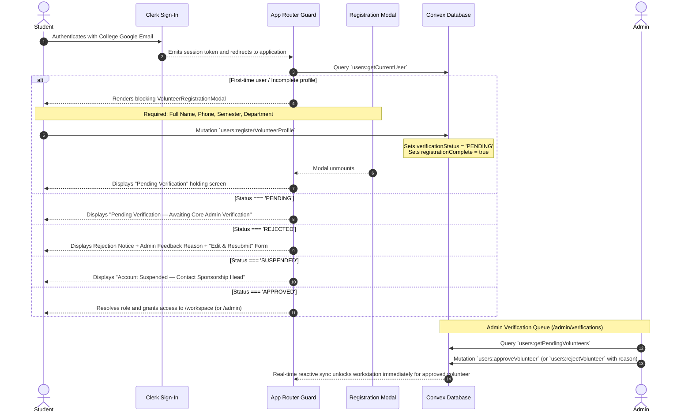
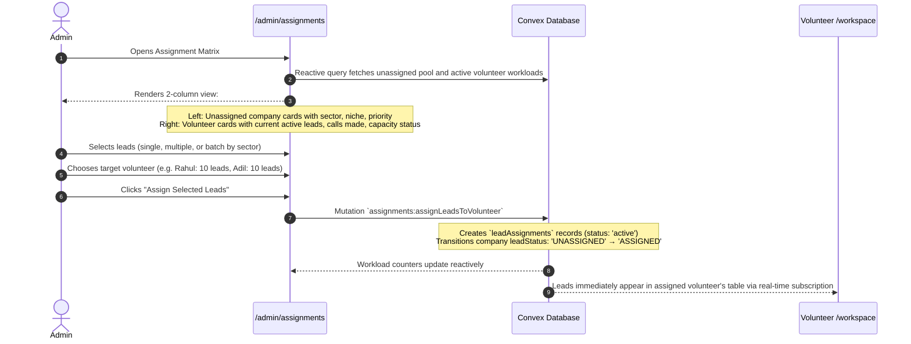
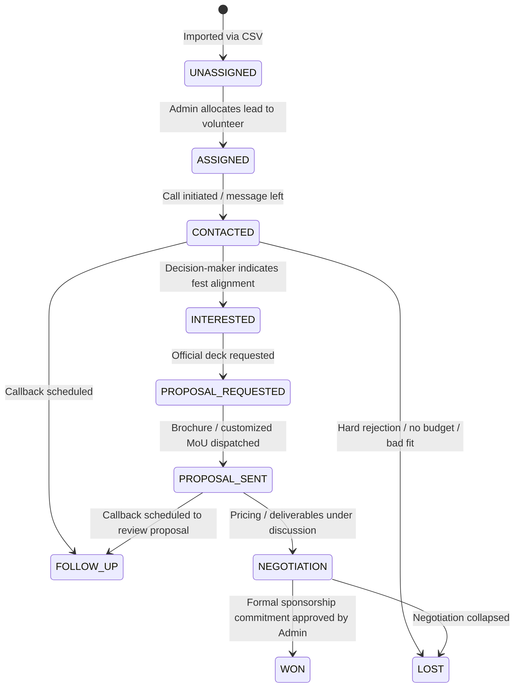

# System Flow & Execution Architecture

This document is the definitive, authoritative source of truth for the distributed execution flows, state machines, authority hierarchies, and operational lifecycles of the **PRAROHA'26 Sponsorship Outreach & Volunteer Execution System**.

---

## 1. Product Purpose & Architectural Focus

The system is an internal operational cockpit built specifically for the student sponsorship committee of PRAROHA'26 (Civil Engineering Department, School of Engineering, CUSAT).

Its sole operational purpose is:
```
LEAD
  ↓
ASSIGNMENT
  ↓
RESEARCH
  ↓
OUTREACH
  ↓
CALL
  ↓
DEBRIEF
  ↓
FOLLOW-UP
  ↓
PROPOSAL
  ↓
NEGOTIATION
  ↓
SPONSORSHIP
```

- **NOT** an event management application or schedule viewer.
- **NOT** a public marketing landing page or ticketing site.
- **NOT** a generic commercial CRM.
- **IS** a focused **Sponsorship Outreach & Volunteer Execution System** optimizing for:
  **SPEED · CLARITY · OUTREACH · FOLLOW-UP · CONVERSION**.

---

## 2. Global System Flow

```
                      AUTHENTICATION (Clerk)
                                ↓
                      ROLE & STATUS DETECTION
                                ↓
                 ┌──────────────┴──────────────┐
                 ↓                             ↓
            ADMIN ROLE                   VOLUNTEER ROLE
                 ↓                             ↓
            ADMIN FLOW                   VOLUNTEER FLOW
```

### 2.1 Complete Admin Flow
```
ADMIN LOGIN
    ↓
ADMIN WORKSPACE (/admin)
    ↓
IMPORT / MANAGE LEADS (/admin/leads)
    ↓
VALIDATE LEADS (Canonical 29-field schema)
    ↓
DUPLICATE CHECK & RESOLUTION
    ↓
ASSIGN LEADS (/admin/assignments)
    ↓
MONITOR OUTREACH & AUDIT CALLS (/admin/reports)
    ↓
MANAGE FOLLOW-UPS (Overdue / Today / Upcoming)
    ↓
MONITOR PROPOSALS (/admin/opportunities)
    ↓
AUTHORIZE SPONSORSHIPS (Exclusive Admin Authority)
    ↓
ANALYZE TEAM PERFORMANCE & CONVERSIONS
```

### 2.2 Complete Volunteer Flow
```
VOLUNTEER LOGIN
    ↓
VERIFICATION CHECK (Admin Gate)
    ↓
VOLUNTEER WORKSPACE (/workspace — Strictly Single-Page)
    ↓
TODAY'S ASSIGNED WORK (Quota, Calls Remaining, Overdue Callbacks)
    ↓
OPEN LEAD (Contextual Slide-Over Drawer)
    ↓
REVIEW COMPANY + CONTACT (Phone Type & Verification Level)
    ↓
REVIEW CALL PREPARATION (Concise Talking Points & Key Facts)
    ↓
START CALL (Transitions to Minimal Focus Call Mode Overlay)
    ↓
CALL OUTCOME (9 Quick Outcome Buttons)
    ↓
VOICE / TEXT DEBRIEF (30–90s Audio Recollection)
    ↓
TRANSCRIPTION & AI ANALYSIS (Whisper STT + LLM Extraction)
    ↓
VOLUNTEER REVIEW & EDIT (Mandatory Confirmation)
    ↓
LEAD STATUS UPDATE + CREATE NEXT ACTION / FOLLOW-UP
    ↓
PROPOSAL REQUEST / NEGOTIATION (Cash + In-Kind)
    ↓
SPONSORSHIP WON / LOST
```

---

## 3. Authentication & Volunteer Verification Flow

Authentication utilizes Clerk for cloud identity. Volunteer authorization is strictly governed by Convex.



### Volunteer Verification Statuses:
- `PENDING`: Initial state upon completing 4-field registration. Access blocked.
- `APPROVED`: Admin verified. Active volunteer with single-page workstation access.
- `REJECTED`: Admin rejected with mandatory reason. User can edit details and resubmit.
- `SUSPENDED`: Access revoked by admin due to campaign completion or policy violation.

---

## 4. Role-Based Flow & Data Scoping

- **ADMIN:** Granted access to `/admin/*` and `/workspace`. Exercises global control over leads, assignments, verification gates, points, and binding commitments.
- **VOLUNTEER:** Strictly confined to `/workspace`. Direct navigation to `/admin/*` routes is blocked by Next.js middleware and server-side Convex authorization guards.
- **Data Scoping Invariant:** Volunteers query **only** leads actively assigned to them (`volunteerId === currentUser._id`). Unassigned leads, peer leads, and admin logs are strictly inaccessible.

---

## 5. CSV Lead Import & Duplicate Engine Flow (P0)

CSV import is a core administrative capability. Leads are **never** automatically assigned during import; assignment is an intentional subsequent admin operation.

```mermaid
sequenceDiagram
    autonumber
    actor Admin
    participant UI as /admin/leads (LeadImportModal)
    participant Parser as Client CSV Parser (lib/csvParser.ts)
    participant Engine as Convex Action (deduplication)
    participant DB as Convex Database

    Admin->>UI: Clicks "Import Leads" and uploads canonical 29-field CSV
    UI->>Parser: Parses raw text and checks schema
    Parser-->>UI: Pre-flight validation on 7 required fields:
    Note over Parser: company_name, industry, niche, priority, contact_name, contact_designation, phone
    alt Missing Required Columns / Malformed Rows
        Parser-->>UI: Displays schema validation error with line numbers
    else Valid Schema
        UI->>Engine: Dispatches parsed rows for duplicate detection
        Engine->>DB: Queries indexes (by_norm_name, by_dedup_hash, by_phone, by_email)
        DB-->>Engine: Returns existing collision records
        Engine-->>UI: Returns Pre-Flight Import Summary:
        Note over UI: TOTAL ROWS · VALID NEW LEADS · DUPLICATES · MISSING DATA
        UI-->>Admin: Displays Duplicate Resolution Table with side-by-side comparison
        Admin->>UI: Chooses action per duplicate (Skip / Merge / Import as New Contact)
        Admin->>UI: Clicks "Confirm & Import Valid Leads"
        UI->>DB: Batch Mutation `companies:importLeadsBatch`
        Note over DB: Inserts companies with leadStatus = 'UNASSIGNED'<br/>Creates contact records with phoneType & contactVerification
        DB-->>UI: Import successful
        UI-->>Admin: Success toast; Leads appear in Unassigned Pool
    end
```

### CSV Schema Specifications:
- **Required Minimum (7 fields):** `company_name`, `industry`, `niche`, `priority`, `contact_name`, `contact_designation`, `phone`.
- **Optional Background Fields (22 fields):** `lead_score`, `email`, `location`, `website`, `linkedin`, `company_size`, `annual_revenue`, `kerala_presence`, `sponsorship_history`, `sponsorship_evidence`, `why_good_lead`, `why_company_benefits`, `recommended_sponsorship_type`, `recommended_ask_min`, `recommended_ask_max`, `alternative_support`, `source`, `source_url`, `contact_source`, `contact_verified`, `notes`, `lead_status`.

---

## 6. Lead Assignment & Workload Balancing Flow (P0)

The admin distributes unassigned leads to approved volunteers based on active capacity:



---

## 7. Volunteer Single-Page Workstation Flow (P0)

The volunteer operates entirely within a single structured workspace (`/workspace`). Multi-page tab routing is prohibited.

```
┌────────────────────────────────────────────────────────────────────────┐
│                        VOLUNTEER WORKSPACE                             │
│                                                                        │
│  ┌──────────────────────────────────────────────────────────────────┐  │
│  │  TODAY'S PRIORITIES: 5 Calls Remaining · 2 Follow-ups Due        │  │
│  │                      1 Proposal Pending · 3 High-Priority Leads  │  │
│  └──────────────────────────────────────────────────────────────────┘  │
│                                                                        │
│  ┌──────────────────────────────────────────────────────────────────┐  │
│  │  ASSIGNED LEAD LIST (High-Density Table)                         │  │
│  │  Company · Contact · Niche · Priority · Status · Next Action     │  │
│  └──────────────────────────────────────────────────────────────────┘  │
│                                                                        │
│  ┌─────────────────────────┐  ┌─────────────────────────────────────┐  │
│  │  FOLLOW-UPS WIDGET      │  │  PERFORMANCE & ACTIVITY TIMELINE    │  │
│  │  Overdue · Today        │  │  Calls Logged · Meetings · Points   │  │
│  └─────────────────────────┘  └─────────────────────────────────────┘  │
└────────────────────────────────────────────────────────────────────────┘
```

---

## 8. Open Lead & Company Intelligence Flow

Clicking a lead opens a slide-over drawer (`LeadDetailDrawer`) to maintain unbroken context:

1. **Company Information:** Company name, industry, niche, company size, annual revenue, Kerala presence, relevant projects, sponsorship history, and sponsorship evidence.
2. **Contact Information:** Contact name, designation, direct phone, email, LinkedIn, contact verification level, and contact source.
3. **Contact Verification Standard:**
   - Displayed as `CONTACT VERIFIED` (with tier chip) or `CONTACT UNVERIFIED`.
   - Displays `PHONE TYPE`: `direct_official`, `office`, `regional_office`, `department`, `switchboard`, or `unknown`.
4. **Sponsorship Information:** Why this company is relevant, why the company benefits from PRAROHA, sponsorship potential, recommended sponsorship type, recommended ask range, and alternative non-cash support.
5. **Call Preparation Section:** Concise, scannable briefing:
   - Objective of the call.
   - 3 Key talking points connecting the company to PRAROHA'26.
   - 3 Questions to ask (probing marketing budgets, hiring needs, brand presence).
   - Company-specific angle.
   - Likely objections and counter-responses.
   - Alternative sponsorship options (in-kind).
   - Budget response guidance.  
   *(Rule: No long rigid sales scripts. Volunteers must be able to absorb points in 5 seconds and speak naturally).*

---

## 9. Call Mode & In-Call Execution Flow (P0)

Clicking **"Start Call"** transitions the UI into a dedicated, distraction-free overlay:

```mermaid
stateDiagram-v2
    [*] --> LeadDetailDrawer: Volunteer clicks lead
    LeadDetailDrawer --> CallModeOverlay: Volunteer clicks "Start Call"
    
    state CallModeOverlay {
        [*] --> InCallFocus
        InCallFocus --> DialTrigger: Displays Contact Name, Designation, Phone (tel: link)
        InCallFocus --> StickyTalkingPoints: Shows 3 concise points & discovery questions
        InCallFocus --> ActiveTimer: Counts call duration in seconds
        InCallFocus --> QuickOutcomeButtons: 9 Quick Action Buttons
    }
    
    QuickOutcomeButtons --> CallCompleted: Volunteer clicks outcome button
    CallCompleted --> DebriefModal: Call Mode closes; Post-Call Debrief opens
```

### 9 Quick Outcome Buttons:
1. `INTERESTED`
2. `PROPOSAL REQUESTED`
3. `ASKED FOR BUDGET`
4. `WRONG PERSON`
5. `CALL BACK`
6. `REJECTED`
7. `NON-CASH OPPORTUNITY`
8. `MEETING REQUESTED`
9. `OTHER`

---

## 10. Call Completion, Voice Debrief & AI Analysis Flow

```mermaid
sequenceDiagram
    autonumber
    actor Vol as Volunteer
    participant Modal as CallReportModal ("How Did The Call Go?")
    participant Storage as Convex File Storage
    participant STT as Convex Action (Whisper STT)
    participant AI as Convex Action (LLM Extraction)
    participant DB as Convex Database

    alt Preferred Mode: Voice Debrief
        Vol->>Modal: Clicks microphone and records 30–90s spoken summary
        Modal->>Storage: Direct upload of audio blob
        Storage-->>Modal: Returns storageId
        Modal->>STT: Action `transcription:transcribeDebriefAudio`
        STT-->>Modal: Returns verbatim transcript
        Modal->>AI: Action `aiActions:extractDebriefInsights`
        AI-->>Modal: Returns structured extraction:
        Note over Modal: Outcome · Interest Level · Decision Maker Status · Objections<br/>Important Info · Requested Action · Next Action · Follow-up Date
        Modal-->>Vol: Displays transcript & structured fields in editable form
        Vol->>Modal: Reviews, modifies text/dates, and confirms accuracy
    else Fallback Mode: Text Debrief
        Vol->>Modal: Manually types notes, selects outcome tags and callback date
    end

    Vol->>DB: Mutation `debriefs:submitDebrief`
    Note over DB: Persists `callDebriefs` record<br/>Updates company `leadStatus`<br/>Updates `lastContactedAt`<br/>Creates `followUps` record (if date set)
    DB-->>Modal: Debrief confirmed; Quota bar increments; Activity feed updates
```

### Modular AI Fallback Rule:
If the external STT or LLM API is unavailable, the modal gracefully falls back to text entry without breaking the volunteer's flow. **AI assists; operations run regardless.**

---

## 11. Lead Status Lifecycle Automation

Lead status transitions follow a confirmed 10-stage progression:



*Rule: Status transitions are confirmed by the user. The system never marks a lead `WON` or `LOST` based solely on AI inference.*

---

## 12. Follow-Up Management Flow

When a callback or deliverable is required:
1. Volunteer sets **Date, Time, Action, and Notes** (e.g., `CALL BACK`, `SEND PROPOSAL`, `SEND BROCHURE`, `CONTACT MARKETING HEAD`, `WAIT FOR INTERNAL APPROVAL`).
2. Persisted in `followUps` with status `pending`.
3. Surfaced prominently across `/workspace` and `/admin`:
   - **OVERDUE:** Highlighted in urgent coral styling (`#F18A70`) with pulse indicator.
   - **TODAY:** Highlighted in yellow styling (`#F5D978`) with 1-click "Call Now" trigger.
   - **UPCOMING:** Listed chronologically for upcoming shifts.

---

## 13. Proposal & Non-Cash Sponsorship Flow (P1)

### 13.1 Proposal Flow
`PROPOSAL_REQUESTED` → Select package tier / custom deliverables → Send deck → Record sent timestamp (`PROPOSAL_SENT`) → Schedule follow-up → `NEGOTIATION` → Formal commitment. All proposals remain permanently attached to the company's relationship timeline.

### 13.2 Non-Cash Opportunity Flow
If a company declines financial sponsorship, volunteers do **not** mark the lead `LOST`. The system triggers a **Non-Cash Opportunity**:
- Categories: `Technical workshop`, `Speaker / Keynote`, `Expert session`, `Prizes`, `Software / Cloud credits`, `Merchandise / T-shirts`, `Equipment / Sound / Lights`, `Venue`, `Printing / Flex`, `Transportation`, `Product support / Food / Drinks`, `Training / Certification`, `Other`.
- Tracks both the in-kind description and estimated monetary valuation in INR to compute `totalPartnershipValue`.

---

## 14. Company Relationship Timeline

Every outreach touchpoint is recorded chronologically on the company dossier:
```
15 Oct, 10:30 AM  →  CALL: Connected with Regional Marketing Head (Rajesh Kumar)
15 Oct, 10:35 AM  →  STATUS CHANGED: INTERESTED
16 Oct, 02:15 PM  →  PROPOSAL REQUESTED: Tier 2 Associate Sponsor Deck
17 Oct, 11:00 AM  →  PROPOSAL SENT: Dispatched via email by Volunteer Rahul
20 Oct, 03:00 PM  →  FOLLOW-UP COMPLETED: Confirmed proposal reviewed by board
23 Oct, 04:30 PM  →  STATUS CHANGED: NEGOTIATION (Pledged ₹50,000 cash + ₹25,000 beverages)
25 Oct, 11:00 AM  →  COMMITMENT AUTHORIZED: Approved by Admin (Lead Status: WON)
```

---

## 15. Admin Monitoring & Team Analytics Flow (P3)

The Admin Workspace prioritizes operational reality over generic vanity metrics:

1. **TODAY'S MOMENTUM:**
   - Calls completed today
   - Decision-makers reached
   - Follow-ups due today & overdue alerts
   - Proposals dispatched
   - Meetings scheduled
   - New opportunities identified
2. **ACTIVE PIPELINE HEALTH:**
   - Funnel breakdown: Assigned → Contacted → Interested → Proposal Requested → Proposal Sent → Negotiation → Won / Lost
   - Financial valuation: Cash pledged vs. In-Kind estimated valuation vs. Total pipeline value
3. **VOLUNTEER ROSTER PERFORMANCE:**
   - Volunteer name, active assigned leads, calls completed, pending callbacks, conversions, and total sponsorship value generated.
4. **POINTS & GAMIFICATION LEDGER:**
   - Points awarded for verified actions: valid call, decision-maker reached, follow-up completed, proposal requested, meeting scheduled, sponsorship closed.
   - Immutable, idempotent ledger in `pointTransactions` guarded by `by_source_id`.

---

## 16. In-Workspace Event Information Flow

Event information is embedded directly inside the workspace (accessible via 1-click modal without leaving the lead):
- **Core Facts:** PRAROHA'26, School of Engineering, CUSAT, Civil Engineering Department, Event Dates, Venue.
- **Audience Demographics:** 5,000+ student footfall, 40+ engineering colleges across South India, disciplines reached.
- **Festival Deliverables:** Flagship competitions, national civil symposium, technical workshops, cultural pro-nights, exhibition stalls, branding banners, website logos, kit bag inserts.
- **Sponsorship Packages:** Title, Powered By, Associate, Technical Partner, In-Kind.
- **Brochure Download:** 1-click trigger to inspect or download the official PDF brochure.

---

## 17. UI Navigation Principle & Architectural Guardrails

- **Zero Tab-Hopping for Volunteers:** All volunteer work occurs on `/workspace` using slide-over drawers (`Sheet`), dialogs (`Dialog`), and the focused `CallModeOverlay`.
- **Operations First, AI Second:** Every form, call report, and lead transition can be executed manually. The system never blocks if AI is unavailable.
- **Strict Typing & Convex Invariants:** All backend mutations independently assert authorization, user verification status, and data ownership.