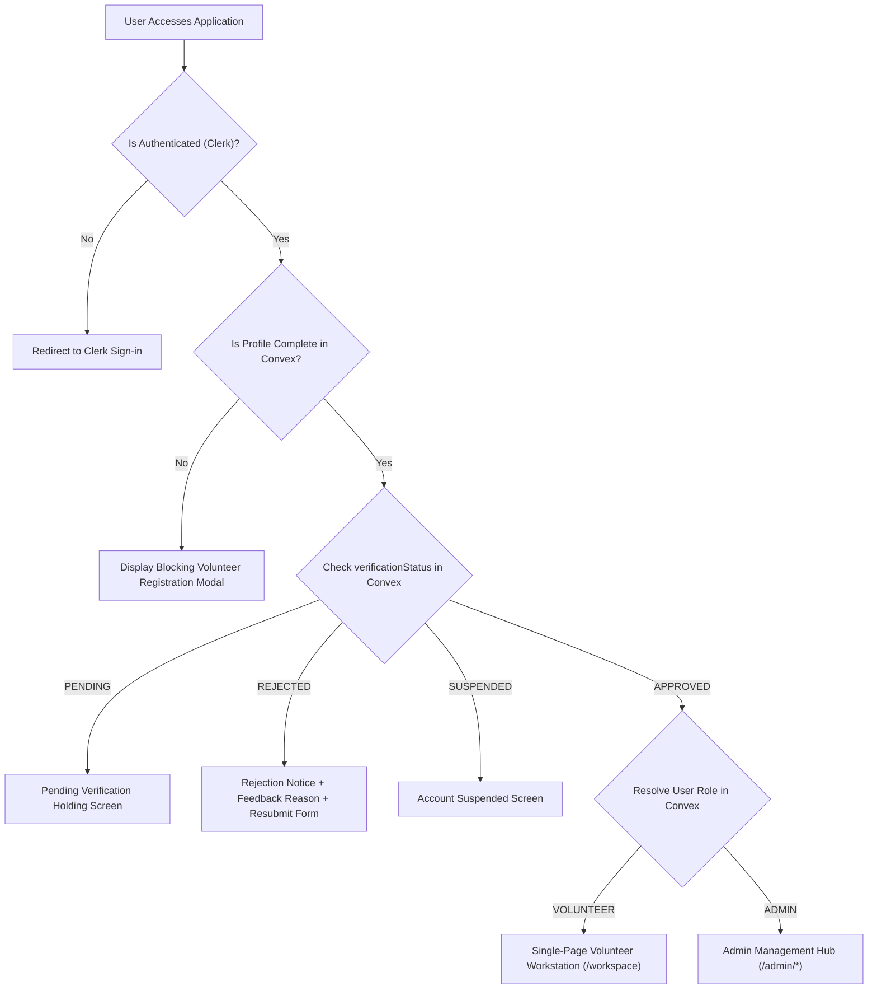
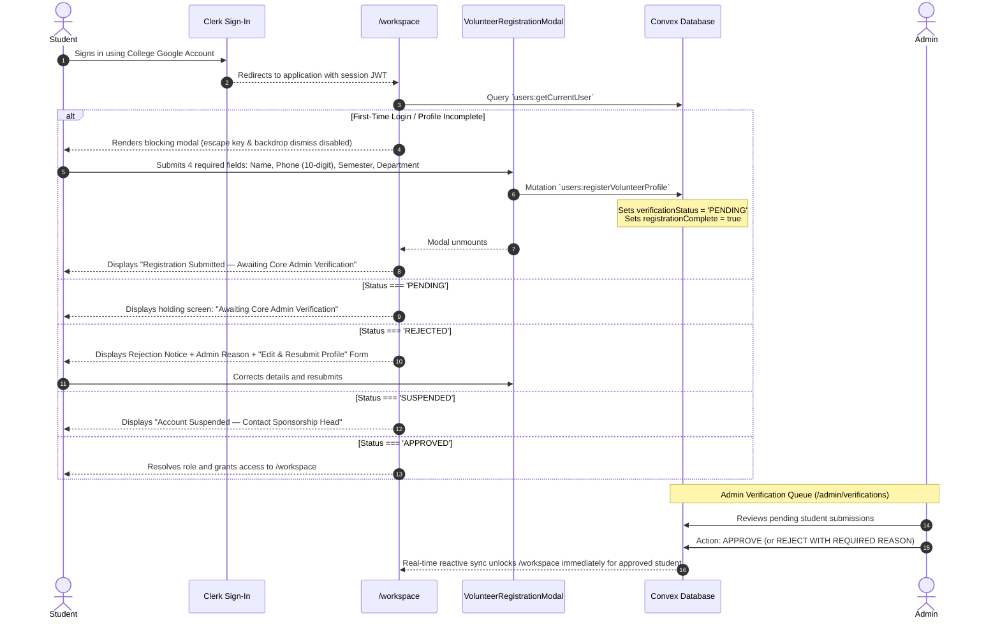
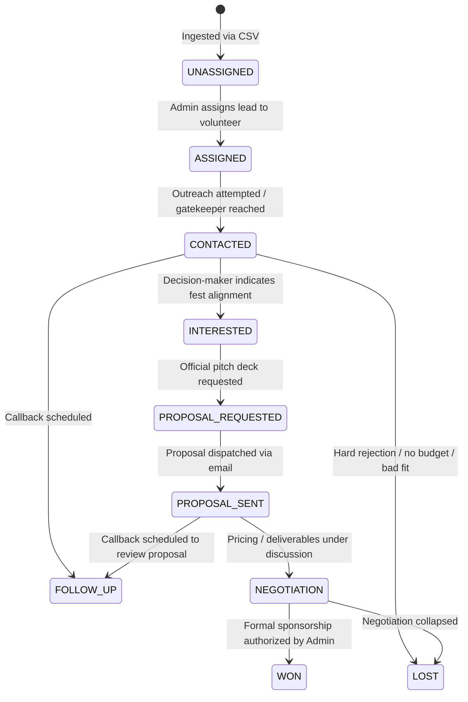
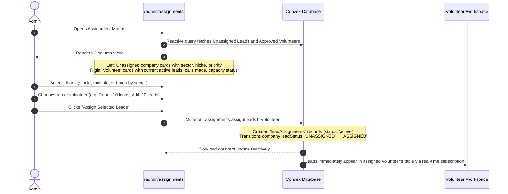

# User Flow & Behavioral Specification

## Definitive Behavioral Source of Truth

> [!IMPORTANT]
> **Document Type:** Behavioral Specification & End-to-End User Journey Reference.  
> **Audience:** Senior Product Designers, UX Architects, Software Architects, and AI Systems Engineers.  
> **Authority:** When any uncertainty arises regarding application routing, user permissions, state transitions, in-call interactions, debrief review, or administrative authorizations, **this document is the final authority**.

---

## 1. Product Purpose & Core Engineering Principle

The **PRAROHA'26 Sponsorship Outreach & Volunteer Execution System** is an internal operational workspace built specifically for the student sponsorship committee of PRAROHA'26 (Civil Engineering Department, School of Engineering, CUSAT).

Its sole operational purpose is:
```
LEAD → ASSIGNMENT → RESEARCH → OUTREACH → CALL → DEBRIEF → FOLLOW-UP → PROPOSAL → NEGOTIATION → SPONSORSHIP
```

### The Product Experience Rule
The entire system is designed around the core principle:
> **"Open the app → See today's sponsorship work → Open a company → Understand who to call → Know what to talk about → Call → Record what happened → Know what to do next → Follow up → Close sponsorship."**

- **NOT** an event management application or public festival site.
- **NOT** a ticketing or LMS platform.
- **NOT** a generic commercial CRM.
- **Avoids:** "Open app → Search through multiple pages → Open CRM tab → Open AI tab → Open call tool → Return to CRM → Update status → Open separate follow-up page."
- **Optimizes for:** **SPEED · CLARITY · OUTREACH · FOLLOW-UP · CONVERSION**.

---

## 2. User Roles & Permission Taxonomy



### Role Access Boundaries
| Role | Access Scope | Operational Authority |
| :--- | :--- | :--- |
| **Unverified Student** | `/`, `/sign-in`, `/sign-up`, Registration Modal | Submit 4-field academic profile; await admin verification. Cannot view leads or contacts. |
| **Volunteer (Student SDR)** | `/workspace` (Strictly Single-Page) | Study assigned companies, enter Call Mode, log voice debriefs, schedule follow-ups, request proposals. |
| **Admin (Sponsorship Head)**| `/admin/*`, `/workspace` | Full access: Import CSVs, detect duplicates, assign leads, audit debriefs, authorize sponsorship commitments, manage points. |

---

## 3. Authentication & Profile Registration Flow

Clerk manages cloud authentication and OAuth sessions. Convex independently enforces registration and verification.



---

## 4. Volunteer Workspace Flow: The Single-Page Rule

> [!CAUTION]
> **Hard Architectural Requirement:** The volunteer experience is **STRICTLY SINGLE-PAGE** on `/workspace`.  
> Do **NOT** create `/workspace/leads`, `/workspace/calls`, `/workspace/followups`, `/workspace/analytics`, or `/workspace/ai`.  
> All volunteer tasks occur in place using drawers, modals, expandable panels, and contextual overlays.

```
┌────────────────────────────────────────────────────────────────────────┐
│                        VOLUNTEER WORKSPACE                             │
│                                                                        │
│  ┌──────────────────────────────────────────────────────────────────┐  │
│  │  TODAY'S WORK COMMAND BAR                                        │  │
│  │  • 5 Calls Remaining    • 2 Follow-ups Due                       │  │
│  │  • 1 Proposal Pending   • 3 High-Priority Leads                  │  │
│  └──────────────────────────────────────────────────────────────────┘  │
│                                                                        │
│  ┌──────────────────────────────────────────────────────────────────┐  │
│  │  ASSIGNED LEAD LIST (High-Density Table)                         │  │
│  │  [Search Bar] [Priority Filter] [Sector Filter] [Status Filter]  │  │
│  │  ──────────────────────────────────────────────────────────────  │  │
│  │  Company · Contact · Niche · Priority · Status · Next Action     │  │
│  │  [Row Action: Click opens LeadDetailDrawer]                      │  │
│  └──────────────────────────────────────────────────────────────────┘  │
│                                                                        │
│  ┌─────────────────────────┐  ┌─────────────────────────────────────┐  │
│  │  FOLLOW-UPS WIDGET      │  │  PERFORMANCE & ACTIVITY TIMELINE    │  │
│  │  • Overdue (Coral)      │  │  • Calls Completed: 12 / 15         │  │
│  │  • Due Today (Yellow)   │  │  • Meetings Booked: 2               │  │
│  │  • Upcoming             │  │  • Points: 140                      │  │
│  └─────────────────────────┘  └─────────────────────────────────────┘  │
└────────────────────────────────────────────────────────────────────────┘
```

---

## 5. Open Lead & Company Detail Drawer Flow

When a volunteer clicks a lead in the table, the application opens `LeadDetailDrawer` (sliding in from the right) — **never a new page**.

### 5.1 Drawer Information Sections
1. **Company Information:**
   - Company name, industry, niche, company size, annual revenue.
   - Kerala regional presence (offices, retail, plants).
   - Relevant projects.
   - Sponsorship history and sponsorship evidence URLs.
2. **Contact Information:**
   - Name, designation, direct phone, email, LinkedIn URL.
   - **Contact Verification Level:** `VERIFIED_DECISION_MAKER` \| `VERIFIED_COMPANY_REPRESENTATIVE` \| `OFFICIAL_COMPANY_CONTACT` \| `UNVERIFIED`.
   - **Phone Type:** `direct_official` \| `office` \| `regional_office` \| `department` \| `switchboard` \| `unknown`.
   - **Contact Source:** Source provenance (e.g. "Alumni Network", "Direct Switchboard").
3. **Sponsorship Intelligence:**
   - Why this company is a good lead.
   - Why the company benefits from PRAROHA'26.
   - Sponsorship potential and recommended sponsorship type (Cash vs. Non-Cash).
   - Recommended ask range (Min / Max in INR).
   - Alternative non-cash support avenues.
4. **Call Preparation (Concise Talking Points):**
   - **Objective:** Clear call goal (e.g., "Secure 15-minute meeting with Regional Marketing Head").
   - **Key Talking Points:** 3 concise bullet points connecting company marketing goals to PRAROHA'26.
   - **Opening Angle:** Natural conversational opening hook (NO memorized scripts).
   - **3 Discovery Questions:** Questions probing budgets, hiring needs, brand presence.
   - **Likely Objections:** Expandable counter-responses for "No budget", "Send email", "Don't sponsor college fests".
   - **Alternative Sponsorship Options:** In-kind goods, workshops, software credits.
   - **Budget Response Guidance:** Quick answers to pricing questions.

---

## 6. Start Call & Call Mode Flow (P0)

Clicking **"Start Call"** inside the drawer transitions the workspace into **Call Mode**:

```mermaid
stateDiagram-v2
    [*] --> LeadDetailDrawer: Volunteer studies lead
    LeadDetailDrawer --> CallModeOverlay: Clicks "Start Call"
    
    state CallModeOverlay {
        [*] --> FocusState
        FocusState --> ContactDetails: Displays Company, Contact Name, Designation
        FocusState --> DirectDialTrigger: Displays clickable phone number (tel: link)
        FocusState --> StickyTalkingPoints: Shows 3 bullet points & discovery questions
        FocusState --> ActiveCallTimer: Elapsed duration counter
        FocusState --> QuickOutcomeGrid: Displays 9 Quick Action Buttons
    }
    
    QuickOutcomeGrid --> CallConcluded: Volunteer clicks quick outcome button
    CallConcluded --> DebriefModal: Call Mode unmounts; Post-Call Debrief opens
```

### 9 Quick Outcome Buttons:
1. `INTERESTED`
2. `PROPOSAL REQUESTED`
3. `ASKED FOR BUDGET`
4. `WRONG PERSON`
5. `CALL BACK`
6. `REJECTED`
7. `NON-CASH OPPORTUNITY`
8. `MEETING REQUESTED`
9. `OTHER`

---

## 7. Call Completion, Voice Debrief & Review Flow

After concluding the call, the **Post-Call Debrief Modal** opens: *"How Did The Call Go?"*

```mermaid
sequenceDiagram
    autonumber
    actor Vol as Volunteer
    participant Modal as CallReportModal
    participant Storage as Convex File Storage
    participant STT as Convex Action (Whisper STT)
    participant AI as Convex Action (LLM Extraction)
    participant DB as Convex Database

    alt Preferred Mode: Voice Debrief
        Vol->>Modal: Clicks microphone icon and speaks natural debrief (30–90 seconds)
        Modal->>Storage: Direct upload of audio blob
        Storage-->>Modal: Returns storageId
        Modal->>STT: Action `transcription:transcribeDebriefAudio`
        STT-->>Modal: Returns verbatim transcript
        Modal->>AI: Action `aiActions:extractDebriefInsights`
        AI-->>Modal: Returns structured extraction:
        Note over Modal: Outcome · Interest Level · Decision Maker Status · Objection<br/>Important Info · Requested Action · Next Action · Follow-up Date
        Modal-->>Vol: Renders transcript and extracted fields in editable form
        Vol->>Modal: Reviews, modifies text, adjusts dates
    else Alternative Mode: Type Notes
        Vol->>Modal: Manually fills qualitative notes, selects outcome tag and follow-up date
    end

    Vol->>DB: Clicks "Confirm & Save Report"
    Note over DB: Persists `callDebriefs` record<br/>Updates company `leadStatus`<br/>Updates `lastContactedAt`<br/>Creates `followUps` record (if callback scheduled)
    DB-->>Vol: Report saved; Quota progress bar increments; Activity feed updates
```

> [!IMPORTANT]
> **AI Extraction Rule:** AI must **never** silently commit call reports without volunteer verification. The volunteer must explicitly review and edit the transcript and extracted fields before saving.

---

## 8. Lead Status Lifecycle Flow

Lead statuses follow an exact 10-stage lifecycle reflecting tangible operational progression:



*Rule: Critical status changes (especially `WON` or `LOST`) require explicit user confirmation. AI never marks a lead `WON` autonomously.*

---

## 9. Follow-Up Management Flow

When a call requires future action:
1. Form captures: **Date, Time, Action, Notes**.
2. Supported Actions: `CALL BACK`, `SEND PROPOSAL`, `SEND BROCHURE`, `CONTACT MARKETING HEAD`, `CONTACT REGIONAL OFFICE`, `WAIT FOR INTERNAL APPROVAL`.
3. Visible prominently on `/workspace` and `/admin`:
   - **OVERDUE:** Highlighted in urgent coral styling (`#F18A70`) with pulse alert.
   - **TODAY:** Highlighted in yellow styling (`#F5D978`) with direct 1-click "Call Now" trigger.
   - **UPCOMING:** Chronological list for future outreach planning.

---

## 10. Proposal & Non-Cash Sponsorship Flow (P1)

### 10.1 Proposal Lifecycle
`PROPOSAL_REQUESTED` → Select package tier or custom deliverables → Dispatch proposal deck → Record sent timestamp (`PROPOSAL_SENT`) → Schedule follow-up callback → `NEGOTIATION` → Formal commitment.

### 10.2 Non-Cash Opportunity Flow
If a company rejects financial sponsorship, volunteers do **not** mark the lead `LOST`. Instead, they select **NON-CASH OPPORTUNITY**:
- **Supported Non-Cash Categories:**
  `Technical workshop`, `Speaker / Keynote`, `Expert session`, `Prizes`, `Software / Cloud credits`, `Merchandise / T-shirts`, `Equipment / Sound / Lights`, `Venue`, `Printing / Flex`, `Transportation`, `Product support / Food / Drinks`, `Training / Certification`, `Other`.
- **Valuation Tracking:** Captures both the in-kind description and estimated monetary valuation in INR to compute:
  $$\text{Total Partnership Value} = \text{Cash Amount} + \text{In-Kind Estimated Value}$$

---

## 11. Sponsorship Commitment Authorization Flow (P1)

Volunteers can propose sponsorship agreements, but final binding authorization belongs **exclusively to the Admin**:

```mermaid
sequenceDiagram
    autonumber
    actor Vol as Volunteer
    actor Admin
    participant Opps as /admin/opportunities
    participant DB as Convex Database

    Vol->>DB: Advances lead to 'NEGOTIATION'
    Vol->>DB: Submits proposed sponsorship commitment:
    Note over DB: Specifies package tier, cash amount, in-kind description & valuation,<br/>attaches signed MoU draft or email proof
    Admin->>Opps: Inspects pending commitment in Authorization Queue
    Admin->>Opps: Verifies promised deliverables against PRAROHA'26 festival guidelines
    alt Terms Unacceptable
        Admin->>DB: Rejects with revision notes; volunteer renegotiates
    else Terms Approved
        Admin->>DB: Clicks "Authorize Commitment" (Exclusive Admin Authority)
        Note over DB: Sets sponsorship status = 'CONFIRMED'<br/>Sets company leadStatus = 'WON'<br/>Creates immutable record in `auditLogs`<br/>Triggers `pointTransactions` to credit volunteer
        DB-->>Opps: Confirmed cash & in-kind totals update in festival macro dashboard
    end
```

---

## 12. Admin CSV Lead Import & Duplicate Engine Flow (P0)

CSV import is an essential P0 capability. Leads are **never** automatically assigned during CSV import.

```mermaid
sequenceDiagram
    autonumber
    actor Admin
    participant UI as /admin/leads (LeadImportModal)
    participant Parser as Client CSV Parser
    participant Engine as Convex Action (deduplication)
    participant DB as Convex Database

    Admin->>UI: Clicks "Import Leads" and drops canonical 29-field CSV
    UI->>Parser: Validates schema and checks 7 required columns:
    Note over Parser: company_name, industry, niche, priority, contact_name, contact_designation, phone
    alt Missing Required Columns
        Parser-->>UI: Displays schema validation error with line numbers
    else Valid Schema
        UI->>Engine: Dispatches parsed rows for collision analysis
        Engine->>DB: Checks indexes (by_norm_name, by_dedup_hash, by_phone, by_email)
        DB-->>Engine: Returns collision list
        Engine-->>UI: Renders Pre-Flight Import Summary:
        Note over UI: TOTAL ROWS · VALID NEW LEADS · DUPLICATES · MISSING DATA
        UI-->>Admin: Displays Duplicate Resolution Table with side-by-side comparison
        Admin->>UI: Selects action per duplicate: SKIP / MERGE / IMPORT AS NEW CONTACT
        Admin->>UI: Clicks "Confirm & Import Valid Leads"
        UI->>DB: Batch Mutation `companies:importLeadsBatch`
        Note over DB: Inserts companies with leadStatus = 'UNASSIGNED'<br/>Creates contact records with phoneType & contactVerification
        DB-->>UI: Batch import confirmed
        UI-->>Admin: Success toast; Leads appear in Unassigned Pool
    end
```

---

## 13. Admin Lead Assignment Matrix Flow (P0)



---

## 14. Performance & Gamification Flow (P3)

1. **Effort vs. Outcome Rewards:**
   - Effort Points: Valid call logged, Decision-maker reached, Follow-up completed.
   - Outcome Points: Proposal requested, Meeting scheduled, Sponsorship won.
2. **Idempotency Guarantee:** Every award in `pointTransactions` is keyed by unique `sourceId` references (e.g. `callDebriefId` or `sponsorshipId`) to eliminate double-awarding.
3. **Real-time Leaderboard Podium:** Located at the bottom of `/workspace`, highlighting top volunteers by verified points, calls completed, and total sponsorship value generated.

---

## 15. In-Workspace Event Information Flow

Event information is embedded directly inside the workspace via `EventInfoModal`:
- **PRAROHA'26 Overview:** Dates, CUSAT, School of Engineering, Civil Engineering Department.
- **Audience Metrics:** 5,000+ student footfall, 40+ engineering colleges.
- **Festival Deliverables:** Competitions, symposiums, stalls, banners, merchandise, website logos.
- **Sponsorship Packages:** Title, Powered By, Associate, Custom, In-Kind.
- **Official Brochure:** In-modal viewer and direct 1-click PDF download.

---

## 16. Modular AI Architecture & Fail-Safe Rule

AI operates strictly as a modular, secondary assistance layer:
1. **Company Intelligence** (Marketing alignment synthesis)
2. **Call Preparation** (3 concise talking points, natural hook, 3 questions)
3. **Objection Handling** (1–2 sentence natural rebuttals)
4. **Voice Transcription** (Server-side Whisper STT)
5. **Call Analysis** (Structured debrief extraction)
6. **Sponsorship Recommendation** (Contextual package and ask range guidance)

### The Fail-Safe Rule:
If external AI APIs fail or experience latency:
- Volunteers can still make calls.
- Volunteers can still type manual debrief notes.
- Volunteers can still advance lead stages and schedule follow-ups.
- Admins can still import CSVs, assign leads, and authorize deals.  
**The application never halts because AI is offline.**
